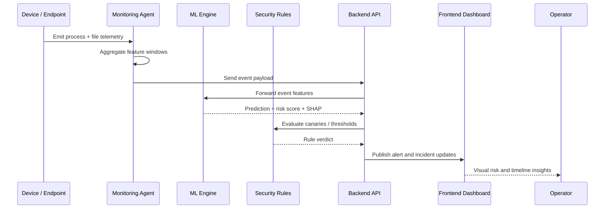
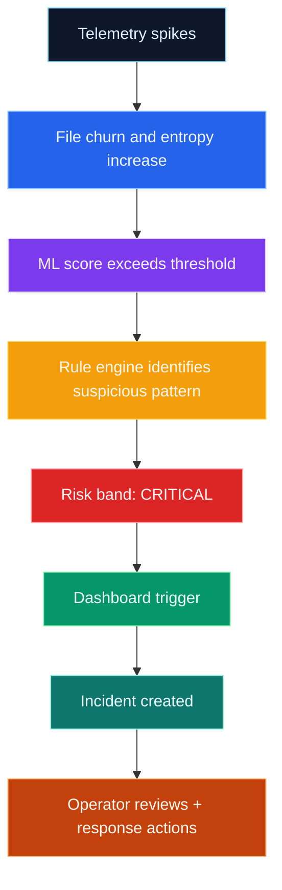

<div align="center">
  
  <br />
  
  
  
  
  <br />
  <h1><b>Cipherveil</b></h1>
  <p>
    <b>Ransomware Early-Warning & Response Platform</b>
  </p>
</div>

<p align="center">
  <i>Detect suspicious behavior early, classify threats with machine learning, and surface actionable response signals before damage spreads.</i>
</p>

---
## ✨ Overview

Cipherveil is an intelligent defense platform built to protect small institutions from ransomware threats by combining:

- behavioral monitoring
- ML-based risk classification
- explainable security scoring
- alert and incident workflows
- a live dashboard for operators

The platform fuses telemetry, model predictions, and response logic into a single early-warning pipeline designed for low-noise detection and fast triage.

---

## 🎨 Architecture at a Glance

```mermaid
flowchart LR
    A[Endpoint / Device Telemetry] --> B[Monitoring Agent]
    B --> C[Feature Aggregation]
    C --> D[ML Risk Engine]
    D --> E[Threat Score + Explainability]
    E --> F[Security Rules & Canary Checks]
    F --> G[Alert Engine]
    G --> H[Backend API]
    H --> I[Dashboard + Admin Console]
    H --> J[Incident / Response Workflow]
    J --> K[Containment Simulation]

    style A fill:#0f172a,stroke:#38bdf8,color:#e2e8f0
    style B fill:#1d4ed8,stroke:#93c5fd,color:#eff6ff
    style C fill:#0ea5e9,stroke:#7dd3fc,color:#ecfeff
    style D fill:#7c3aed,stroke:#c4b5fd,color:#f5f3ff
    style E fill:#a21caf,stroke:#e9d5ff,color:#faf5ff
    style F fill:#f59e0b,stroke:#fcd34d,color:#fff7ed
    style G fill:#dc2626,stroke:#fca5a5,color:#fff1f2
    style H fill:#059669,stroke:#86efac,color:#ecfdf5
    style I fill:#0f766e,stroke:#99f6e4,color:#ecfeff
    style J fill:#ea580c,stroke:#fdba74,color:#fff7ed
    style K fill:#44403c,stroke:#d6d3d1,color:#fafaf9
```



---

## 🧩 Core Modules

| Module | Purpose | Stack |
|---|---|---|
| `monitoring/` | Captures device activity and telemetry windows | Python, psutil, JSONL |
| `ml/` | Trains and runs the ransomware detection model | Python, XGBoost, SHAP |
| `backend/` | Stores events, alerts, incidents, and exposes APIs | FastAPI, SQLAlchemy |
| `security_module/` | Canary logic, heartbeat checks, and simulated response actions | Python |
| `frontend/` | Dashboard for monitoring, incidents, and risk views | React, Vite |

---

## Server-Side File-Log Detection Add-on

The monitoring agent groups file creates, modifications, deletes, and renames into
one-second windows. `monitoring/backend_bridge.py` sends each window to the backend
and the ML service with its source event ID. The ML service runs a dedicated
Isolation Forest over those numeric file-log features, using up to
2,000 historical windows from `monitoring/telemetry.jsonl` as its baseline. A fresh
deployment can calibrate from 32 low-churn windows if it has no history yet. For a
separate ML host, set `SERVER_LOG_HISTORY_FILE` to its mounted server-side telemetry
archive path.

Set the monitoring and ML device credentials in ignored local files copied from
`monitoring/.env.example` and `ml/.env.example`; keep those `.env` files out of Git.

The dashboard reports baseline size, scored windows, the latest anomaly score, and
mean inference time. The ML service exposes the same operational summary at
`GET http://localhost:8020/status`. Scores at or above 99.9/100 create a review alert,
rate-limited to one per minute. These file-log alerts do not trigger simulated
isolation on their own.

This is an unsupervised workload-anomaly signal, separate from the labeled XGBoost
classifier used for its own behavioral feature set. The baseline should be collected
from representative benign workloads; the score is a prototype signal and is not a
measured production false-positive or detection rate.

---

## 🔐 What the system detects

Cipherveil focuses on early behavioral anomalies such as:

- unusual file creation or modification bursts
- rapid renaming and encryption-like activity patterns
- suspicious process behavior
- abnormal entropy shifts
- extension anomalies and canary-triggered indicators
- persistence and file-system behavioral signatures

The model produces a calibrated risk score and an explainable threat summary so defenders can understand why an alert was raised.

---

## 🚀 End-to-End Workflow



---

## 🏗️ Repository Structure

```text
cipherveil/
├── backend/                  # FastAPI backend and data layer
│   ├── app/
│   ├── requirements.txt
│   └── README.md
├── frontend/                 # React dashboard for observability
│   ├── src/
│   └── package.json
├── ml/                       # Training, inference, and explainability
│   ├── src/
│   ├── data/
│   ├── models/
│   ├── reports/
│   └── README.md
├── monitoring/               # Telemetry collector and safe simulator
│   ├── monitor.py
│   ├── api.py
│   └── README.md
├── security_module/           # Canary, heartbeat, reset, response logic
│   ├── main.py
│   ├── rules.py
│   └── response.py
├── .gitignore
├── LICENSE
└── README.md
```

---

## 🧪 Quick Start

### 1) Start the monitoring layer

```bash
cd monitoring
python -m venv .venv
source .venv/bin/activate   # Windows: .venv\Scripts\activate
pip install -r requirements.txt
python monitor.py
```

### 2) Configure the security module

Copy `security_module/config.example.json` to `security_module/config.json` and set
`backend_api_key` to a device key issued by the backend. Keep the local config file
private; it is excluded from Git. For the resilience demo, use
`security_module/config_resilience_demo.example.json` as the starting point instead.

For the dashboard's security simulation buttons, copy `frontend/.env.example` to
`frontend/.env.local` and set `VITE_SECURITY_DEVICE_KEY` to the same demo device key.
This key is included in the browser bundle, so use only a dedicated, limited demo key;
never use a production credential.

### 3) Launch the ML engine

```bash
cd ml
python -m venv .venv
source .venv/bin/activate   # Windows: .venv\Scripts\activate
pip install -r requirements.txt
python src/train.py
python src/evaluate.py
```

### 4) Start the backend API

```bash
cd backend
python -m venv .venv
source .venv/bin/activate   # Windows: .venv\Scripts\activate
pip install -r requirements.txt
python run.py
```

### 5) Run the frontend dashboard

```bash
cd frontend
npm install
npm run dev
```

---

## 📊 Example Threat Flow



---

## 🛡️ Security Goals

- Detect ransomware before data encryption becomes irreversible
- Reduce false positives through model + rule fusion
- Explain why a score is elevated
- Provide operational visibility through a clean dashboard
- Keep handling safe and simulation-oriented in early demos

---

## 📌 Why Cipherveil?

Because ransomware defense is not just about detection — it is about understanding risk early, triaging it accurately, and giving teams the context to act before the damage spreads.

Cipherveil brings together monitoring, ML intelligence, and response workflows into one defense-oriented platform.

---

## 🌟 Roadmap

- [ ] Harden telemetry collection for production environments
- [ ] Add richer feature engineering and anomaly detection
- [ ] Improve explainability for operator consumption
- [ ] Add automated response playbooks
- [ ] Expand dashboard insights and incident correlation
- [ ] Support multi-device, multi-site deployments

---

<div align="center">
  
  <br />
  <p><b>Built for early detection. Engineered for clarity. Designed for action.</b></p>
</div>
